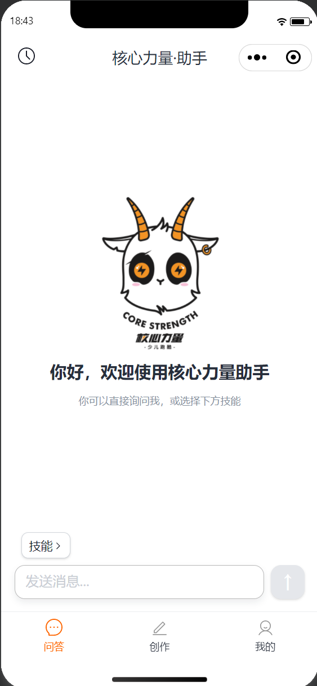
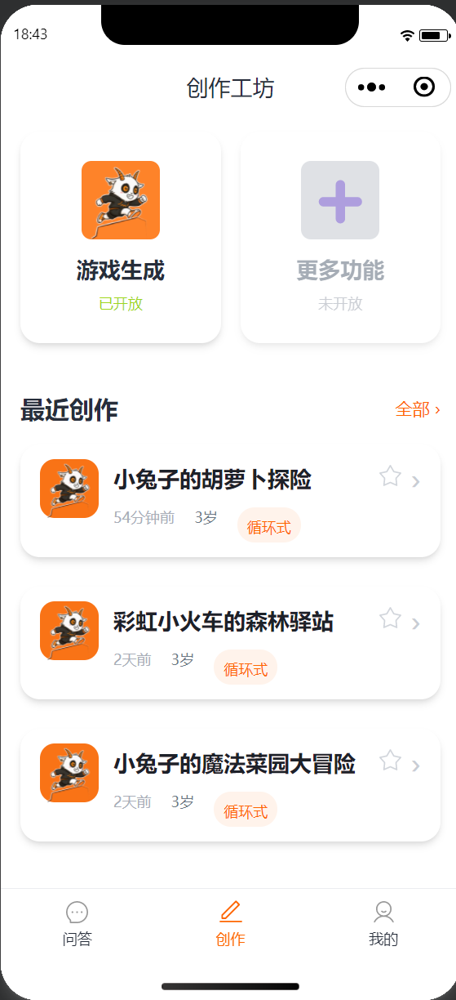
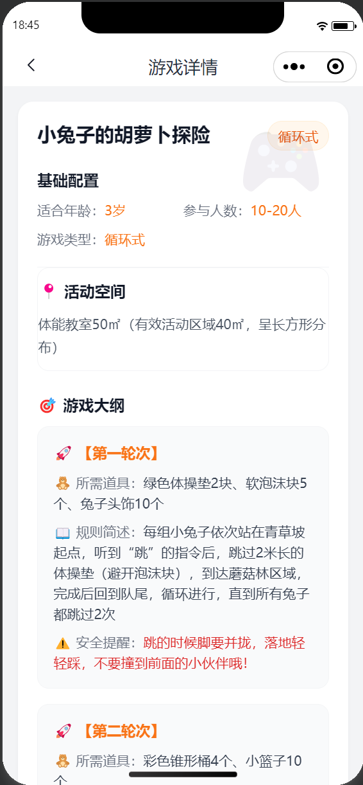
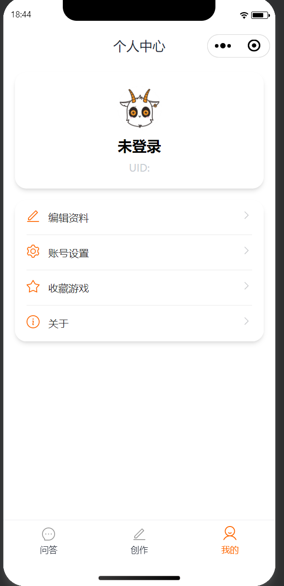
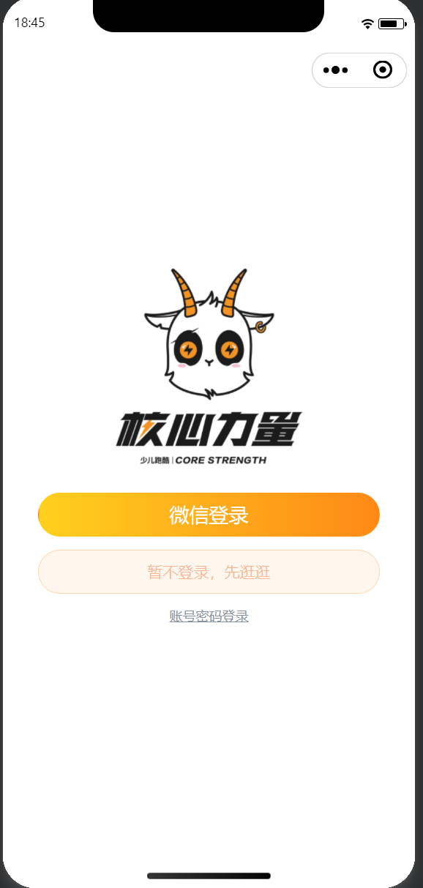

# Core Coach · AI 核心教练

基于 Taro 4.x 开发的微信小程序，提供 AI 智能创作、游戏生成、音乐播放、作品收藏与分享等功能。

## 功能预览

| 首页 | 创作向导 | 作品详情 |
|------|----------|----------|
|  |  |  |

| 个人中心 | 登录 |
|----------|------|
|  |  |

## 功能模块

### AI 智能对话
- WebSocket 实时流式对话，支持 Markdown 渲染
- 多会话管理，会话切换与删除
- 消息复制、中断回复、选项卡切换
- 未登录用户可浏览

### 创作向导
- 四步创作流程：参数配置 → 音乐设置 → 异步生成 → 结果展示
- 年龄选择、游戏类型筛选
- 背景音乐试听、切换与下载
- 异步任务轮询，生成完成订阅通知

### 作品收藏 & 列表
- 下拉刷新分页列表，一键回到顶部
- 收藏/取消收藏，状态即时同步
- 最近创作 / 全部创作 / 我的收藏

### 微信分享
- 好友转发 + 朋友圈分享 + 复制链接
- 详情页、结果页全页面支持

### 个人中心
- 用户信息展示、头像上传
- 密码修改、账号登出

## 技术栈

| 分类     | 技术                |
| -------- | ------------------- |
| 框架     | Taro 4.x            |
| 语言     | TypeScript          |
| 状态管理 | Zustand             |
| 样式     | Tailwind CSS + SCSS |
| 通信     | WebSocket           |
| 包管理   | pnpm                |

## 项目结构

```
core-coach/
├── config/                 # Taro 编译配置
├── src/
│   ├── api/               # API 接口层
│   ├── assets/            # 静态资源
│   ├── components/        # 公共组件
│   ├── config/            # 路由配置
│   ├── constants/         # 常量定义
│   ├── hooks/             # 自定义 Hooks
│   ├── pages/
│   │   ├── chat/          # AI 对话
│   │   ├── creation/      # 创作首页
│   │   ├── wizard/        # 创作向导
│   │   ├── result/        # 生成结果
│   │   ├── detail/        # 作品详情
│   │   ├── more/          # 更多列表
│   │   ├── favorite-games/ # 收藏列表
│   │   ├── login/         # 登录
│   │   ├── profile/       # 个人中心
│   │   └── account-settings/ # 账号设置
│   ├── services/          # HTTP + WebSocket 服务
│   ├── store/             # Zustand 状态管理
│   ├── types/             # TypeScript 类型定义
│   └── utils/             # 工具函数
├── docs/images/           # 项目截图
├── package.json
└── tsconfig.json
```

## 开始开发

```bash
# 安装依赖
pnpm install

# 微信小程序开发模式
pnpm dev:weapp

# 构建微信小程序
pnpm build:weapp
```

## 环境变量

| 文件 | 用途 |
|------|------|
| `config/dev.ts` | 开发环境 |
| `config/prod.ts` | 生产环境 |
| `.env` | 环境变量 |

## 许可证

本项目为私有项目，未经授权不可使用。
